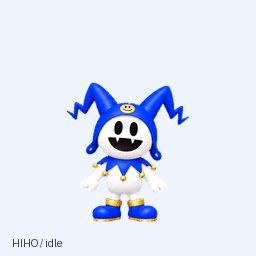
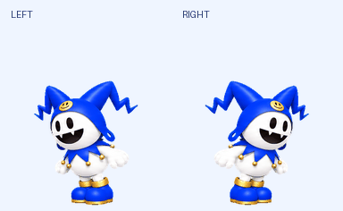

# HIHO Pet

杰克霜精（Jack Frost / ジャックフロスト）的非官方同人桌宠。

## 下载

| 平台 | 状态 | 下载 |
| --- | --- | --- |
| Codex Pets | 1.0.1 | [完整资源包](https://github.com/VictorHugo043/HihoPet/raw/refs/heads/main/packages/HIHO-Codex-1.0.1.zip) · [透明图集](Codex/spritesheet.png) |
| macOS 独立桌宠 | 0.3.4 · Apple Silicon | [下载安装包](https://github.com/VictorHugo043/HihoPet/releases/download/macos-0.3.4/Hiho-0.3.4-macOS-arm64.zip) · [安装说明](desktop/INSTALL-macOS.md) |
| Windows 独立桌宠 | 待制作 | — |

## Codex 桌宠

提供待机、跃行、挥手、工作状态和十六方向转头。资源包以欢呼嘴形和动作表达“Hi-ho！”，不含音频。

将资源包解压到 `~/.codex/pets/hiho/`，确保 `pet.json` 和 `spritesheet.png` 位于该文件夹根目录，然后在 Codex 的宠物选择器中选择 Hiho。浮窗、鼠标跟随和工作状态切换由宿主客户端提供。

## macOS 桌宠

[桌面应用](desktop/README.md) 使用 Electron + TypeScript。单击随机叫出 Hi-ho，双击跳跃；拖起时会挣扎，快速来回拖动或持续绕圈逗它会转晕，醒后跺脚生气再消气。点击时显示叫声对话条，眩晕和生气有独立叫声；轻抚头部会眯眼。右键可喂雪球、逗它追鼠标、跟随系统音乐律动，以及跳舞、睡觉、调整大小和安静模式。代码、动画与手势逻辑供 macOS 和 Windows 共用，Windows 包待验证。

音乐律动采用底部固定的坐姿，随音量压缩、变宽和伸展；“⚡️‌HIHOの酒⚡️‌”直接播放内置音频（出处 [BV1hXbN6VEKV](https://www.bilibili.com/video/BV1hXbN6VEKV/)），配合轻微透视摇转。连续五分钟没有互动会睡着，单击唤醒。

## 权利与使用

应用代码采用 [MIT](desktop/LICENSE)；美术素材与文档采用“保留所有权利（All rights reserved）”标记，详见 [LICENSE](LICENSE)。Jack Frost 及相关游戏、角色、录音与商标权益归 ATLUS、SEGA 及各自权利人所有。本项目不授予这些第三方权益，也不代表官方授权。叫声来源及分发限制见 [素材说明](desktop/THIRD_PARTY.md)。
